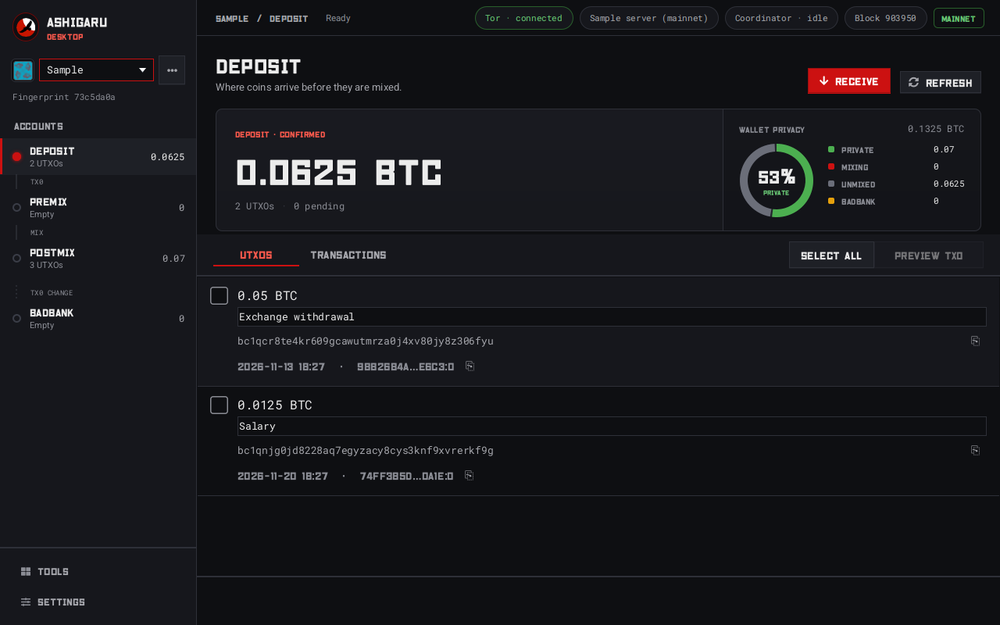
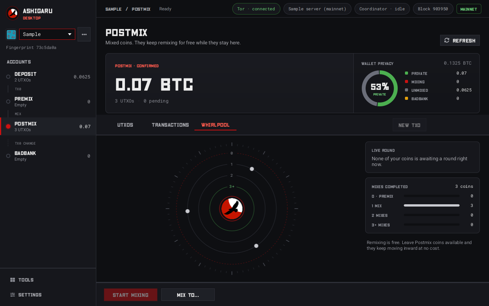
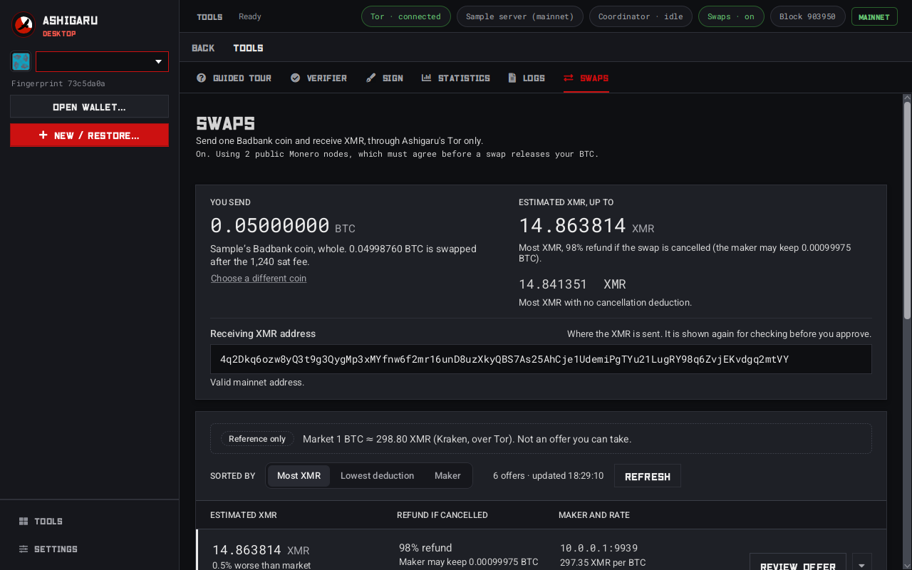
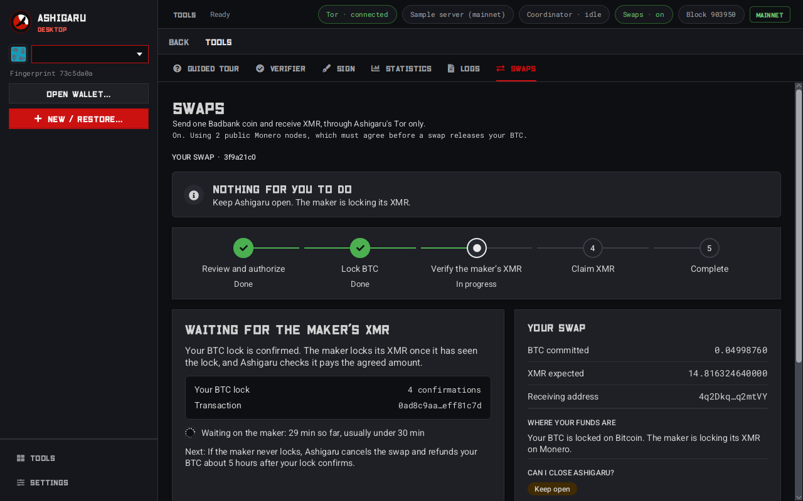
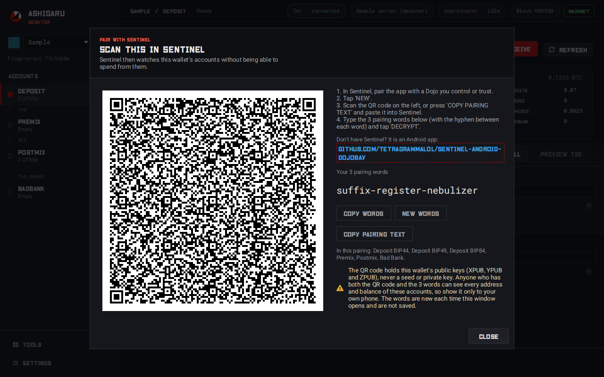
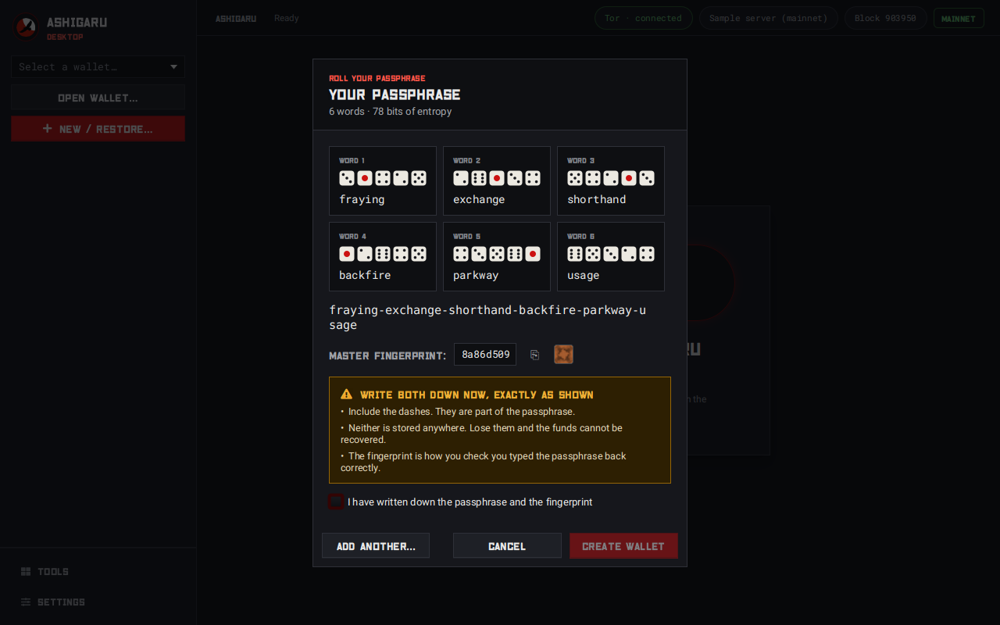
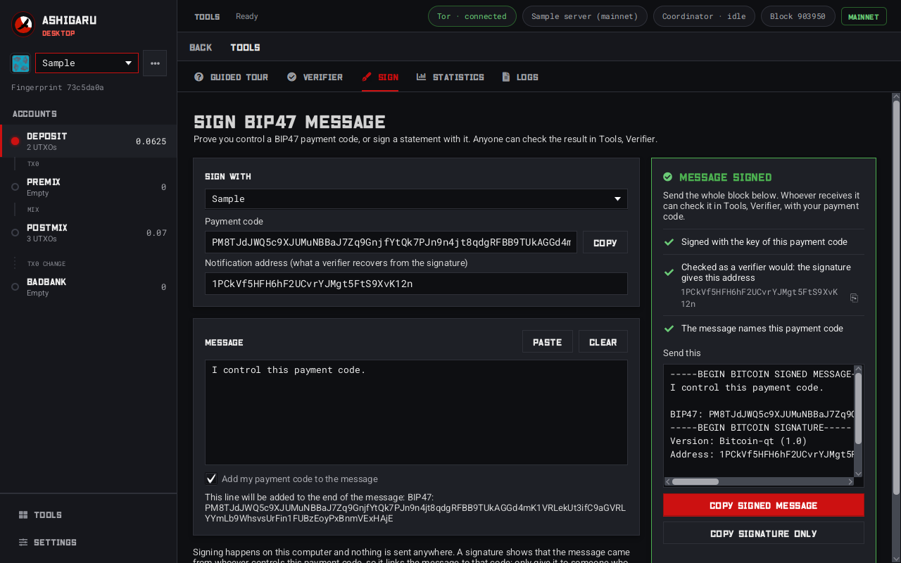
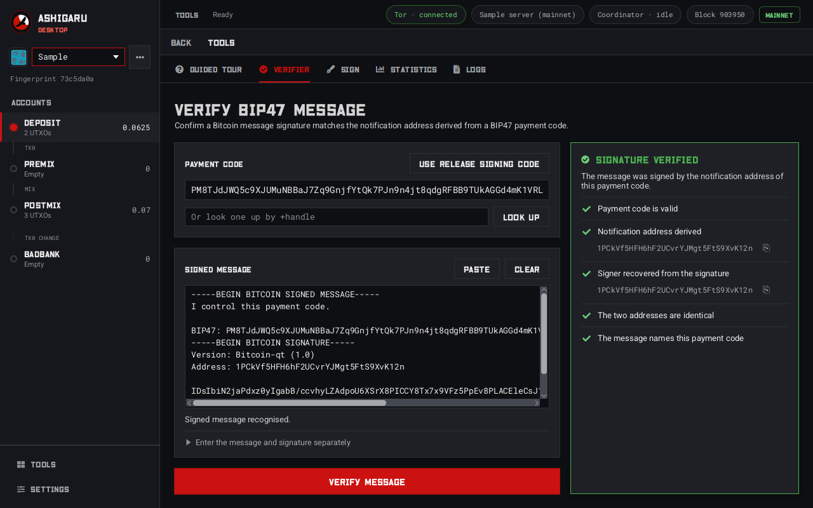

# Ashigaru Desktop

A privacy-first Bitcoin wallet for the desktop, built around Whirlpool coinjoin. It is the graphical companion to [Ashigaru Terminal](https://ashigaru.rs) and Ashigaru Mobile: receive here, mix through Premix and Postmix, and spend from mobile. Everything goes over Tor by default.

<p align="center">
  
</p>

---

### Features

The full list, with a picture of each screen, is in [docs/FEATURES.md](docs/FEATURES.md).

**Mixing**
- **Whirlpool coinjoin.** Tx0, zeroleak coinjoin, and Deposit / Premix / Postmix / Badbank account management, with a Whirlpool view of how many mixes each coin has done.
- **Mix To.** Send mixed outputs on to an offline or different wallet.
- **Status lights.** The top bar shows Tor, your server, the Whirlpool coordinator, the swap engine, the block height and the network at a glance.

**Swaps (BTC to XMR)**
- **Badbank coin to Monero.** Swap one Badbank coin for XMR through the eigenwallet 5.0.4 swap engine, over Tor only. Off by default (Settings → Swaps), mainnet only, and it needs a build that includes the swap engine.
- **Offers compared on what you receive.** Estimated XMR, refund percentage if the swap is cancelled, and how far each maker is from the market.
- **Protection from a worse price.** If the maker's final terms give you more than 2% less XMR than the offer you chose, a "Price changed" window asks you; more than 5% less, or a changed refund policy, and the swap is refused. Nothing is locked until you approve the final review.
- **A dashboard for every swap.** Where your funds are, whether you need to do anything, and what happens if the swap stalls. A running swap is cancelled and refunded by Ashigaru itself when the timelock allows.

**Wallets**
- **Receive only.** Spending happens on mobile, which keeps the desktop's attack surface small.
- **Dice-rolled passphrases.** Creating a wallet walks you through rolling a diceware BIP39 passphrase with physical dice. Restoring a wallet accepts the passphrase it already has, or none.
- **Pair with Sentinel.** Wallet menu → a QR code plus three one-time words that [Sentinel](https://github.com/tetragrammalol/sentinel-android-dojobay) (Android, Dojo Bay edition) scans to watch the wallet (XPUB/YPUB/ZPUB public keys only).
- **Import / export labels.** Move your labels to and from any BIP-329 wallet.
- **PayNym robot.** The open wallet's PayNym robot sits beside its name, and BIP47 transactions show the counterparty's PepeHash avatar. Both are fetched from paynym.rs through Tor.
- **UTXO analysis.** Check your own UTXOs with AmIExposed or BitHypha.

**Privacy and network**
- **Built-in Tor.** Every connection goes through the bundled Tor. If it gets stuck, right-click the connection status (or open **Settings → Server**) to request a new Tor identity or restart Tor.
- **Dojo Bay integration.** Connect to geographically dispersed Electrum servers whose operators have signed their pairing with BIP47.
- **A warning before anything leaves Tor.** Links that open in your browser (block explorers, AmIExposed) go through a "Leaving Tor" window first.

**Tools**
- **Guided tour.** A short walkthrough of wallets, accounts, receiving and mixing, shown on first run and available from Tools at any time.
- **BIP47 message signer and verifier.** Sign a message as your wallet's payment code, and check that a message was signed by the holder of a payment code, including Ashigaru's own release signatures.
- **Statistics.** The pools you mix in, from whirlpoolstats.xyz (h/t Black Coffee).
- **Logs.** Look under the hood and share application logs with developers. Addresses, keys and wallet names are redacted by default.

**Updates and trust**
- **Verified in-app updates.** When you allow it, Ashigaru finds new releases and checks them against the release signing key before you install.
- **Signed, attested releases.** See *Verifying a release* below.
- **Every build says which build it is.** The window title, About and Logs show the version and the commit.

### Screenshots

The pictures use a made-up wallet and sample data. Nothing in them belongs to a real wallet or a real swap.

<table>
  <tr>
    <td width="50%"><br><sub>A wallet on its Deposit account, with the status lights along the top</sub></td>
    <td width="50%"><br><sub>Postmix, in the Whirlpool view</sub></td>
  </tr>
  <tr>
    <td width="50%"><br><sub>Swaps: offers compared on what you receive</sub></td>
    <td width="50%"><br><sub>A swap in progress: where the funds are, and what to do</sub></td>
  </tr>
  <tr>
    <td width="50%"><br><sub>Pair with Sentinel</sub></td>
    <td width="50%"><br><sub>Creating a wallet: the rolled passphrase and its fingerprint (example only)</sub></td>
  </tr>
  <tr>
    <td width="50%"><br><sub>Tools → Sign</sub></td>
    <td width="50%"><br><sub>Tools → Verifier</sub></td>
  </tr>
</table>

More pictures are in [docs/FEATURES.md](docs/FEATURES.md).

### Roadmap

- **Dojo integration.** Get all the benefits of Dojo, such as Nextblock fee estimates, personal Electrum server details and more.

---

### Download

Pre-built binaries for every platform are published on the [Releases](../../releases) page.

| Platform | Package | Min OS | Notarized |
|---|---|---|---|
| Windows | `Ashigaru-X.Y.Z.exe` installer | Windows 10 | — |
| macOS (Apple Silicon) | `Ashigaru-X.Y.Z-aarch64.dmg` | macOS 11.0 | No, ad-hoc signed |
| macOS (Intel) | `Ashigaru-X.Y.Z-x86_64.dmg` | macOS 11.0 | No, ad-hoc signed |
| Linux | `Ashigaru-X.Y.Z-x86_64.AppImage` | — | — |

Each release also includes `SHA256SUMS`, `MESSAGE.txt`, and `RELEASE-BIP47-SIGNATURE.txt` for verification.

**Upgrading from 1.4.x.** Until 1.4.5, Linux releases also shipped `.deb`, `.rpm` and `.tar.gz` packages, and Windows releases shipped an `.msi`. From 1.5.0 there is one package per platform. The in-app updater offers the AppImage on Linux and the `.exe` on Windows. Once the new version is running you can uninstall the old package; your wallets live in `~/.ashigaru` (or `%APPDATA%\Ashigaru`) and are not touched.

**macOS installation**

Requires macOS 11.0 (Big Sur) or later. macOS builds are ad-hoc signed but not Developer ID signed or notarized. On macOS Ventura and later, Gatekeeper is stricter for quarantined, non-notarized apps downloaded from the internet — ad-hoc signing alone does not satisfy trust requirements, and you may see "damaged and can't be opened" or a blocked launch. This can also indicate a bad signature or packaging issue, so verify the file hash first (see *Verifying a release* below).

If the hash checks out, two options:

**Option A — Remove quarantine (recommended for nightly builds):**

1. Mount the DMG
2. Copy `Ashigaru.app` to `/Applications`
3. Open Terminal and run:

```sh
xattr -rd com.apple.quarantine /Applications/Ashigaru.app
```

4. Open normally

If you already copied it to Applications:

```sh
xattr -rd com.apple.quarantine /Applications/Ashigaru.app
```

**Option B — Open Anyway via System Settings:**

After a blocked launch attempt, go to **System Settings → Privacy & Security** and click **Open Anyway** next to the Ashigaru entry.

> Developer ID signing and notarization require an Apple Developer Program account. Current macOS packages are ad-hoc signed only, which is common for open-source desktop applications distributed without a paid Apple license.

---

### What these builds are

These release builds are published by the GitHub account `linkinparkrulz`, from this repository, by the release workflow in `.github/workflows/release.yaml`. Two independent records let you check them, and it helps to know what each one does and does not tell you:

| Check | What it shows | What it does not show |
|---|---|---|
| **Release signature** (`RELEASE-BIP47-SIGNATURE.txt`, steps 1 to 3 below) | The release message, and through it every file's checksum, was signed by whoever holds the release-signing key listed below. | That the files were built from this source, or that any other project or person vouches for them. |
| **Build provenance** (step 4 below) | Which workflow, commit and runner produced each file, as recorded by GitHub when the release was built. | Who published it (that is the signature's job), or that the build is bit-for-bit reproducible (see [Reproducible Builds](docs/ReproducibleBuilds.md) for rebuilding it yourself). |

Neither check means that anyone else endorses these builds. Both together say: this file was built by this repository's workflow at this commit, and the maintainer who holds the signing key signed that release.

### Verifying a release

Every release is signed by the maintainer using the private key for the notification address derived from the Ashigaru release-signing BIP47 Payment Code. This lets users verify that the release message was signed by the owner of the payment code, without exposing private keys.

From 1.4.5, **Settings → Update** performs every check below for you and shows each one as it passes, refusing and deleting anything that fails. (1.3.0 shipped the updater but cannot reach GitHub — see the 1.4.5 release notes — so it has to be replaced by hand.) The manual steps remain here for anyone verifying a download obtained outside the app, or checking the app's own work.

**Release signing identity**

- **PayNym:** https://paynym.rs/+linkinparkrulz
- **BIP47 Payment Code:**

```text
PM8TJM51x2mDd85CzEgVc2y7vdyB3eBj93JVjVtCt6PZtmfzhFzYPMXYBXh28zthWhVKGjVQZPT1MKxGxEtfenLYEkuc5GhoWtMzQCF8c8mrckYFM7r1
```

- **Notification address:** `1K8CDoBYWBuaeAhejLAk5hiACAgbbPnDCJ`

That address is derived from the payment code above, and is what every release signature must
recover to. It is published here so you can confirm the recovered signer without deriving it
yourself.

**Step 1 — Verify the file hash**

```bash
sha256sum -c SHA256SUMS --ignore-missing
```

Confirm the downloaded binary appears as `OK`.

**Step 2 — Verify the hash commitment in MESSAGE.txt**

```bash
sha256sum SHA256SUMS
```

Compare the output against the `SHA256(SHA256SUMS): ...` line inside `MESSAGE.txt`. They must match.

**Step 3 — Verify the Bitcoin message signature**

Open `RELEASE-BIP47-SIGNATURE.txt`. It is a standard Bitcoin signed message block: the contents of `MESSAGE.txt` between `-----BEGIN BITCOIN SIGNED MESSAGE-----` and `-----BEGIN BITCOIN SIGNATURE-----`, then the signing address and a base64 signature.

The simplest check is in Ashigaru itself — **Tools → Verifier**, use the release signing code, paste the whole file into the signed message box (it is read as you paste), then choose Verify Message. You can also use Ashigaru Mobile or a BIP47 message verifier such as https://paymentcode.io/lab with:

- **Payment Code**: the release signing payment code above
- **Message**: the exact contents of `MESSAGE.txt`
- **Signature**: the base64 value from `RELEASE-BIP47-SIGNATURE.txt`

The verifier derives the notification address from the payment code and checks the signature against it. Confirm the recovered signer is the notification address published above — that is what ties the release to the maintainer's key.

**Step 4 — Verify the build provenance**

Releases built from 1.5.2 onward also carry a GitHub build attestation for each file. With the [GitHub CLI](https://cli.github.com/):

```bash
gh attestation verify Ashigaru-<version>-x86_64.AppImage --repo linkinparkrulz/ashigaru-desktop
```

It must report that the file was built by the `release.yaml` workflow of `linkinparkrulz/ashigaru-desktop`, from the tag you expect (and the commit named in `MESSAGE.txt`). The release signature (steps 1 to 3) is still the check that ties a release to the maintainer's key; the attestation is the check that ties a file to the source and workflow that built it.

---

### Build from source

Requires JDK 21 (Temurin recommended).

```bash
git clone https://github.com/linkinparkrulz/ashigaru-desktop.git
cd ashigaru-desktop
./gradlew jpackage
```

The packaged application is written to `build/jpackage/`.

On Linux, `./gradlew jpackage` builds a `.deb`; the AppImage that releases ship is built with:

```bash
./gradlew packageAppImage
```

The AppImage task downloads `appimagetool` from the official AppImageKit continuous release and writes the package to `build/distributions/`.

For proving reproducibility, see docs [here](docs/ReproducibleBuilds.md).

___

### Documentation

- [Architecture](docs/ARCHITECTURE.md) — module layout, UI structure, Whirlpool deep dive
- [Development](docs/DEVELOPMENT.md) — build, run and test workflow for contributors
- [Reproducible Builds](docs/ReproducibleBuilds.md) — independently verify a release binary
- [Seed Entropy Analysis](docs/SeedEntropyAnalysis.md)
- [Release Testing Checklist](docs/TESTING.txt)

---

### Software license:

Ashigaru Desktop is released under the Free and Open Source license [GNU GPLv3](LICENSE).

**Declaration as per Apache v2.0, section 4:** Ashigaru Desktop has been forked from/built upon [Sparrow wallet Source Code](https://web.archive.org/web/20250525130614/https://github.com/sparrowwallet/sparrow/releases/tag/1.8.4), v1.8.4 released 7th March 2024. Additionally the Sparrow wallet Source Code for [Nightjar library](https://web.archive.org/web/20250528121847/https://github.com/sparrowwallet/nightjar), including commits up to and including 14th February 2024, has been imported as a module directly into this Ashigaru Desktop code repository. Original source code was released under license Apache v2.0, and changes/modifications under this Ashigaru Open Source Project code repository are done so under the GNU GPLv3 license.

<br>
