# Ashigaru Desktop: every feature

This is the long version of the feature list in the [README](../README.md). Each section says what a feature does, where to find it, what (if anything) it
sends over the network and to whom, and what it cannot do. The pictures use a made-up wallet and sample data, drawn by the real application
(see *Regenerating the pictures* in [DEVELOPMENT.md](DEVELOPMENT.md)). Nothing in them belongs to a real wallet, address or swap.

Swaps need a build that includes the swap engine, and the first build with engine 5.0.4 has not yet met a real maker. Everything else works in every build.

- [Getting started](#getting-started)
- [Creating and restoring a wallet](#creating-and-restoring-a-wallet)
- [The wallet screen](#the-wallet-screen)
- [Mixing with Whirlpool](#mixing-with-whirlpool)
- [Pair with Sentinel](#pair-with-sentinel)
- [Swaps: Badbank coin to Monero](#swaps-badbank-coin-to-monero)
- [Tools](#tools)
- [Settings](#settings)
- [What leaves your computer](#what-leaves-your-computer)
- [Updates, releases and builds](#updates-releases-and-builds)

## Getting started

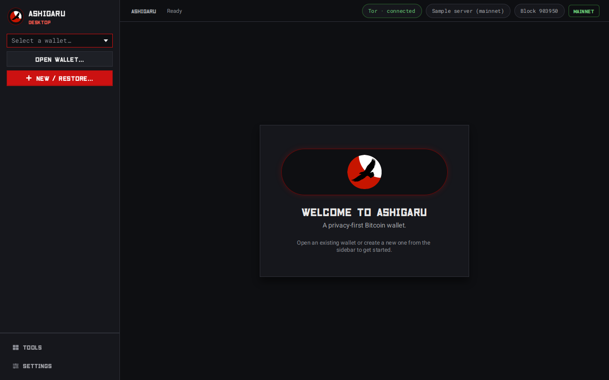

With no wallet open, the sidebar offers **Open Wallet…** and **New / Restore…**. The window opens at 1280 x 800 and does not get smaller than that
(on a screen with less room it takes the usable screen).

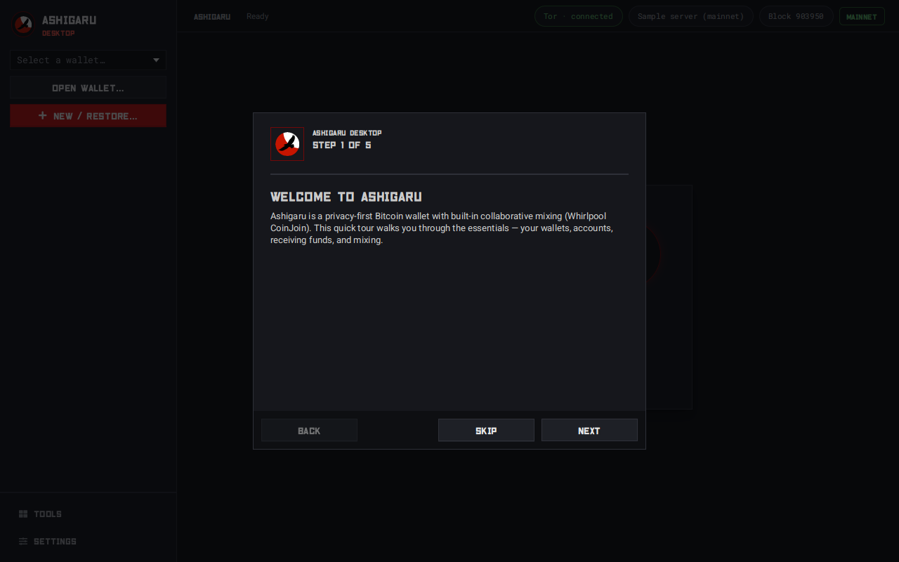

**Guided tour.** Five short steps on wallets, accounts, receiving and mixing, shown on first run. It is always available from **Tools → Guided Tour**.

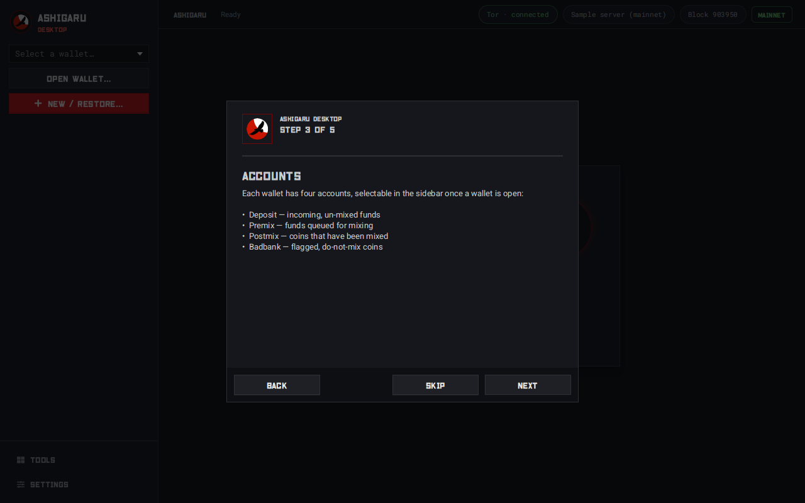

## Creating and restoring a wallet

**New / Restore…** walks through a short series of windows. Nothing is sent anywhere.

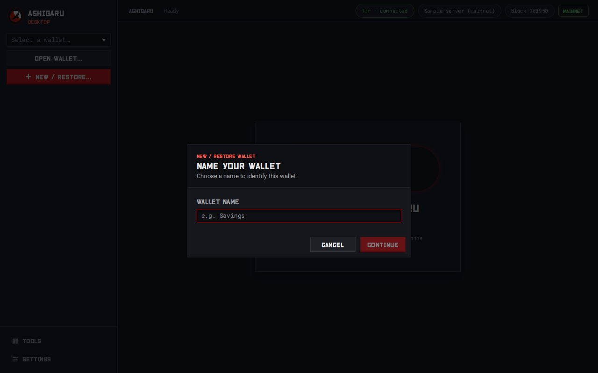
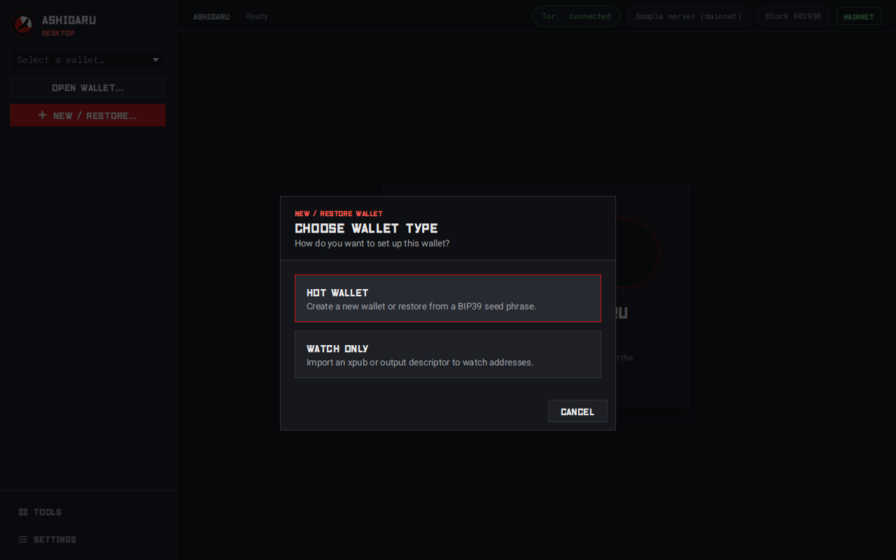

- **Hot Wallet** creates a new BIP39 wallet or restores one from its seed words. **Watch Only** imports an xpub or output descriptor.
- A seed of 12 or 24 words (24 is recommended for a new wallet), generated here or entered.

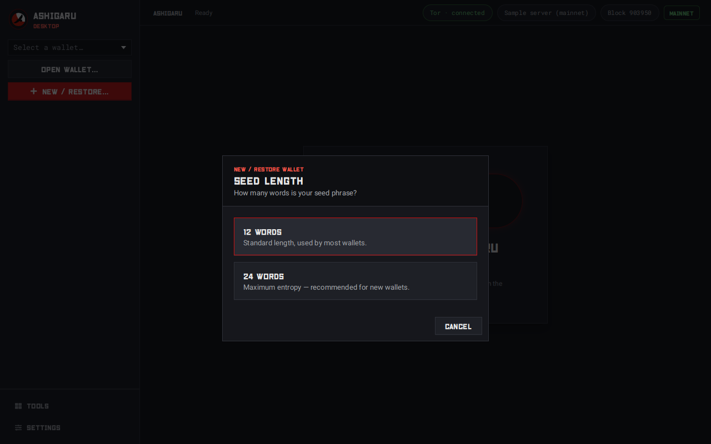

**A passphrase, not a password.** Ashigaru explains the difference and offers to roll one with physical dice: five dice per word, at least six words, with the
entropy shown as you go. Restoring a wallet accepts the passphrase it already has, or none.

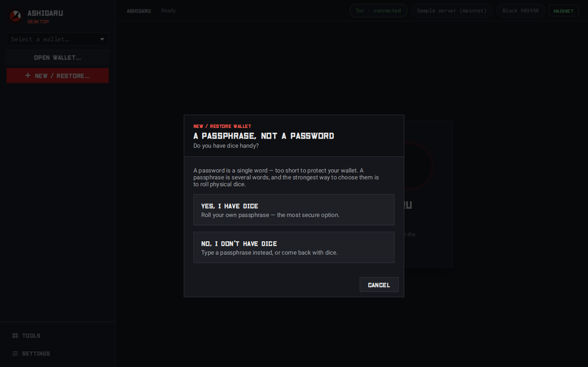
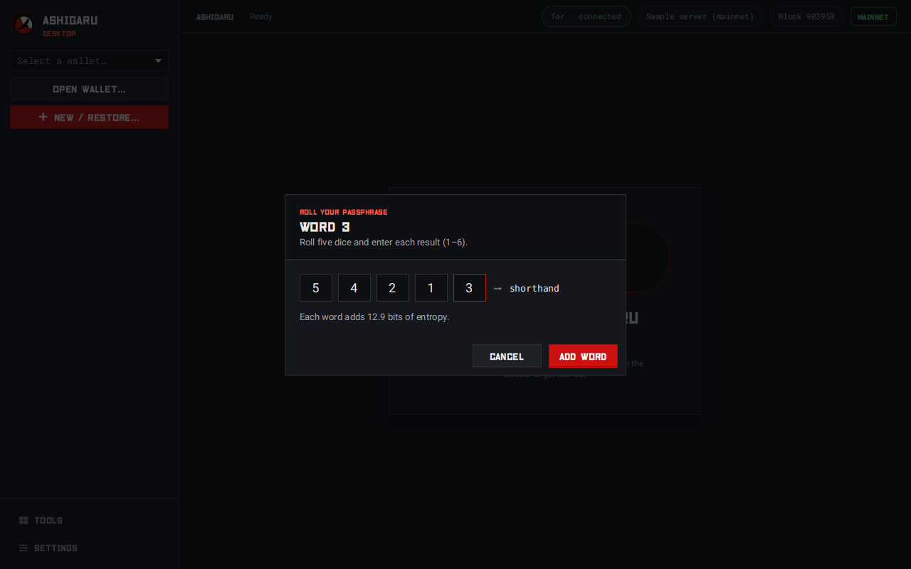

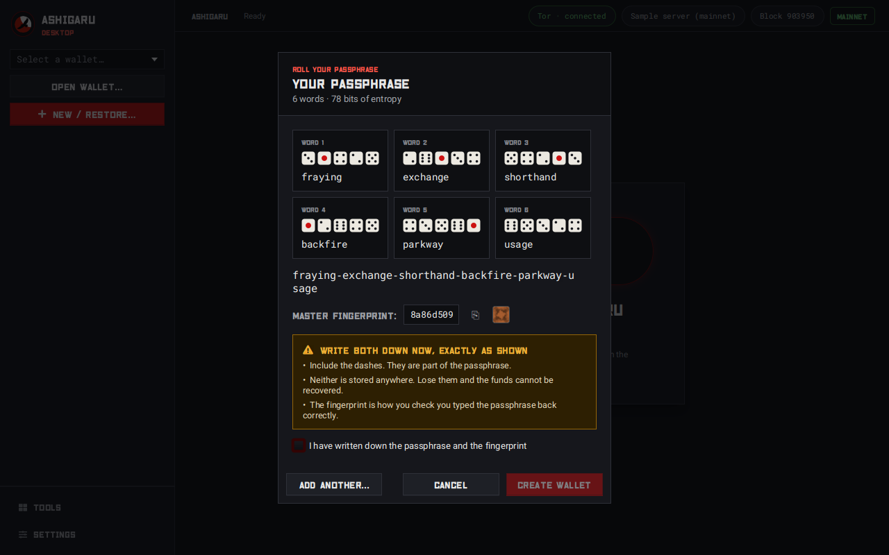

The review shows each word with its dice, the joined passphrase and the **master fingerprint**. The fingerprint is how you check you typed the passphrase back
correctly later. Neither the passphrase nor the fingerprint is stored anywhere.

## The wallet screen

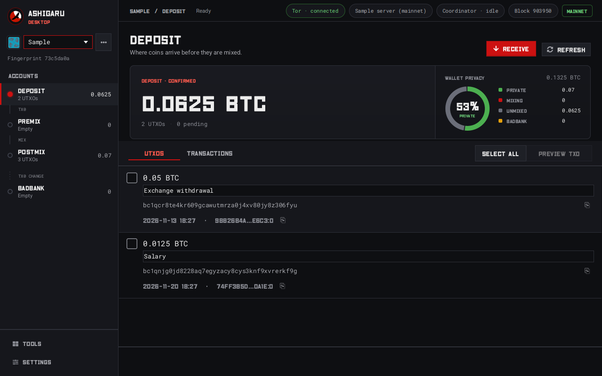

- **Accounts.** Deposit, Premix, Postmix and Badbank are listed in the sidebar in the order coins move through them, with their balances.
- **Wallet picture.** The wallet's PayNym robot sits beside its name once the server is connected (until then, and if it cannot be fetched, a picture drawn from the
  wallet's fingerprint on this computer). The fingerprint is written under the name.
- **Privacy summary.** The share of the wallet's balance that is private (mixed), mixing, unmixed or in Badbank.
- **UTXOs and Transactions.** Each coin shows its amount, label (editable in place), address, date and transaction. BIP47 transactions show the counterparty's
  PepeHash avatar.

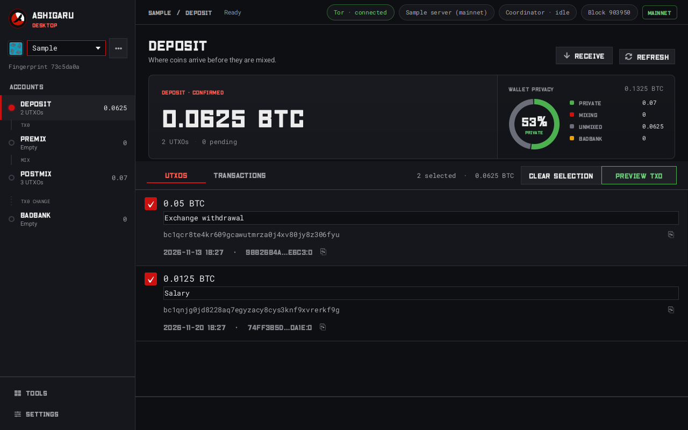

Tick coins to act on them: **Preview Tx0** on Deposit, **Remix selected** on Postmix, **Swap to XMR** on Badbank when swaps are on.

### Receive

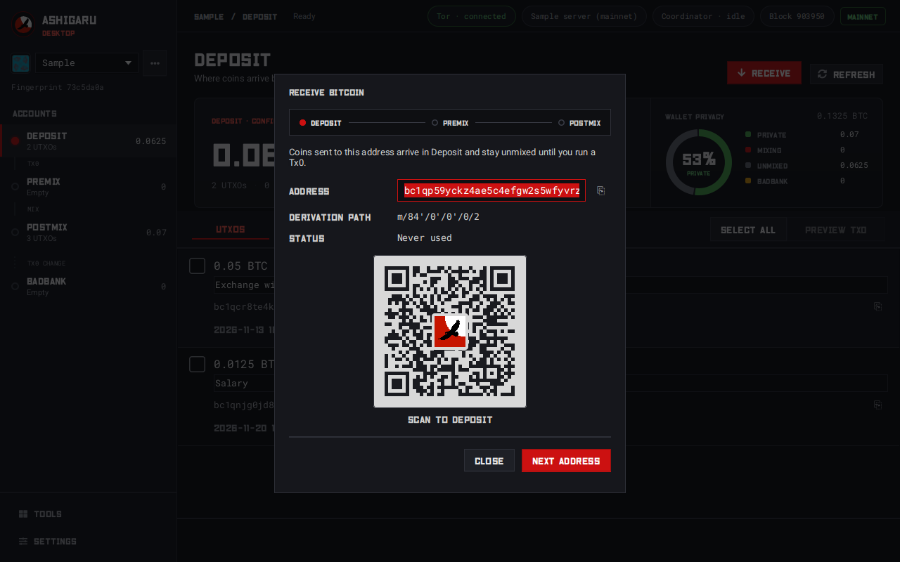

**Receive** on the Deposit account shows the next unused address, its derivation path and status, and a QR code. **Next address** moves on.

### The wallet menu

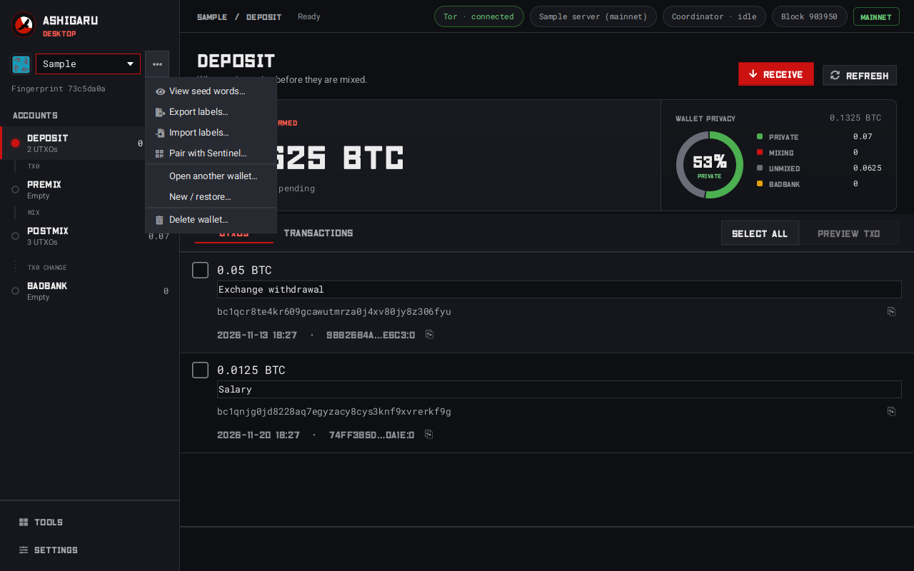

- **View seed words…** (asks for the password of an encrypted wallet).
- **Export labels… / Import labels…** in the BIP-329 format, to move labels to and from any wallet that supports it.
- **Pair with Sentinel…** (below).
- **Open another wallet… / New / restore… / Delete wallet…**

A wrong wallet password gives one plain message, and the password window is the same compact one everywhere.

## Mixing with Whirlpool

- **Tx0** splits Deposit coins into Premix coins. Tick coins on Deposit and press **Preview Tx0**; the window shows the Tx0 with its fees, including the Anti-Sybil fee, before anything is sent. It needs a connected server.
- **Start Mixing** and **Mix To…** are at the foot of the Postmix and Premix screens. **Mix To…** sends mixed outputs on to an offline or different wallet.
- **Premix** coins wait for a round. **Postmix** coins are mixed and keep remixing for free while they stay in Postmix.
- **Badbank** holds coins flagged as not to be mixed (Tx0 change, for example).
- Dots on a coin show its completed mixes.

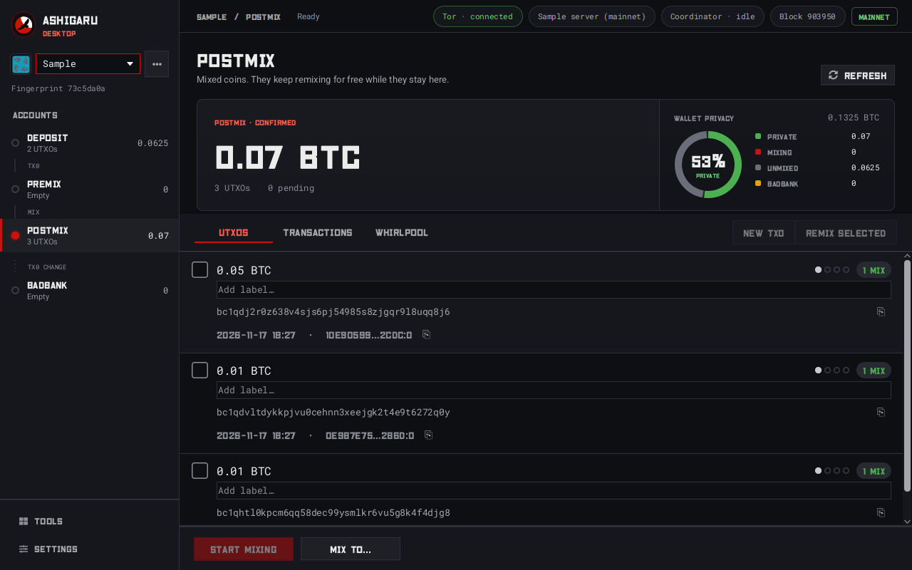

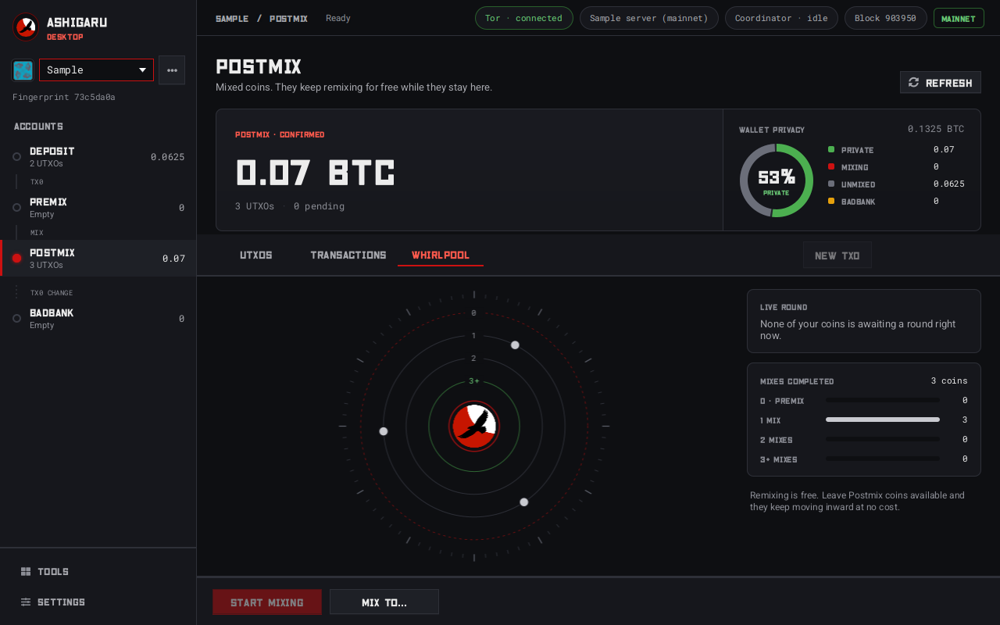

The Whirlpool view shows each coin on a ring by completed mixes, with a count of how many coins are at each level, and says plainly when none is waiting for a round.
**Coordinator** in the top bar says whether the Whirlpool coordinator answered (hover for why); it only appears while Whirlpool is running.

Mixing talks to the Whirlpool coordinator and the Dojo/Electrum server you use, through Tor.

## Pair with Sentinel

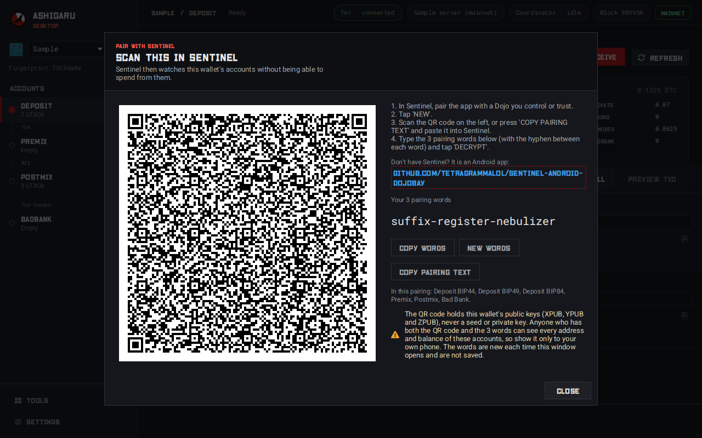

Wallet menu → **Pair with Sentinel…** lets [Sentinel](https://github.com/tetragrammalol/sentinel-android-dojobay) (Android, Dojo Bay edition) watch this wallet.

1. In Sentinel, pair the app with a Dojo you control or trust.
2. Tap **NEW**.
3. Scan the QR code, or press **Copy pairing text** and paste it into Sentinel.
4. Type the three pairing words (with the hyphens between them) and tap **DECRYPT**.

What is in the QR: the Deposit BIP44, BIP49 and BIP84 keys, Premix, Postmix and Bad Bank, and the wallet fingerprint. They are public keys only (XPUB, YPUB and ZPUB),
never a seed or private key. An encrypted wallet asks for its password once, because the BIP44 and BIP49 keys are worked out from the seed. Keys the wallet does not
have are left out and the window says which. **New words** makes different words and a different QR; the old ones stop working. Nothing is saved, logged or sent
anywhere. Anyone who holds both the QR and the words can see the accounts' addresses and balances, so show it only to your own phone.

The link to Sentinel opens through the *Leaving Tor* window.

## Swaps: Badbank coin to Monero

Turn swaps on in **Settings → Swaps**. They are off by default, mainnet only, and need a build with the swap engine (eigenwallet 5.0.4). Swaps use Ashigaru's Tor only.
**Tools → Swaps** then lists your swaps and the offers for a Badbank coin. A **Swaps** light in the top bar says whether the engine is running.

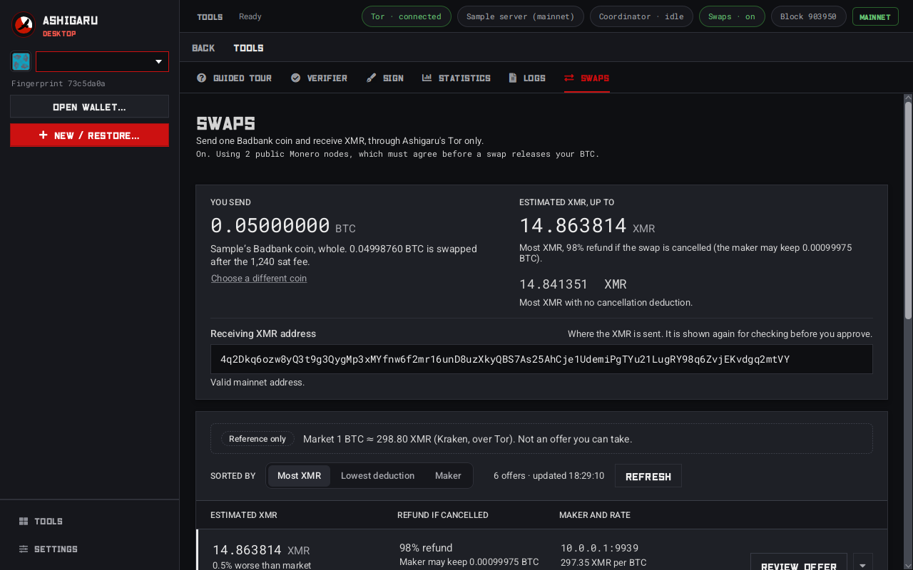

1. **Choose a coin.** On Badbank, tick one coin and press **Swap to XMR**. The whole coin is swapped, with no change.
2. **Enter your receiving XMR address.** It is checked as you type and shown again before you approve.
3. **Compare the offers.** Each shows the estimated XMR for your coin, the refund if the swap is cancelled ("98% refund" means the maker may keep 2% as an
   anti-spam deposit), the maker and its rate, and how far it is from the market price (a reference taken over Tor, not an offer). Sort by most XMR, lowest deduction or maker.
   Offers that cannot take your coin, run outdated software, or pay more than the market (makers that undercut the market refuse swaps) are left out and counted.
4. **Review offer.** Ashigaru asks for your wallet password once (the swap protocol makes the taker prove it controls the coin), contacts the maker over Tor, and gets its final terms.
5. **Check the price.** If the final terms give you more than 2% less XMR than the offer you chose, a window shows both amounts and the difference:

   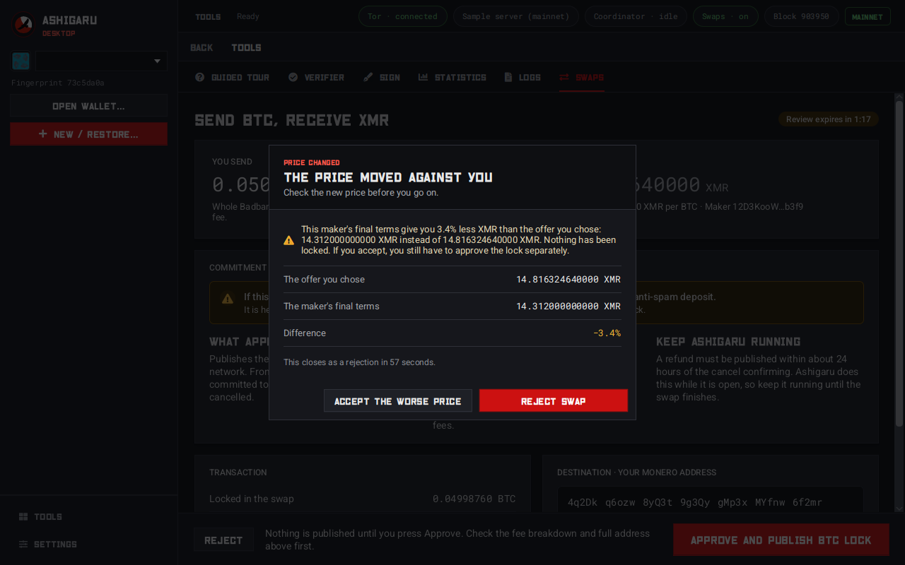

   **Reject swap** is the default answer, Esc and the window's X also reject, and the window counts down with the approval time. More than 5% less, or a changed refund policy,
   and the swap is refused without asking. Nothing is locked yet in any of these cases.
6. **Approve the final review.**

   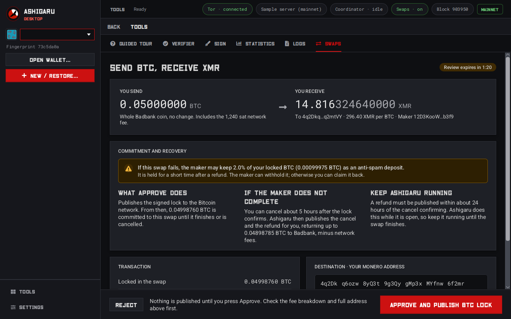

   It leads with what you send and receive, the destination and the maker's deposit, then the recovery terms. Nothing is published until you press **Approve and publish BTC lock**.
7. **Watch the dashboard.**

   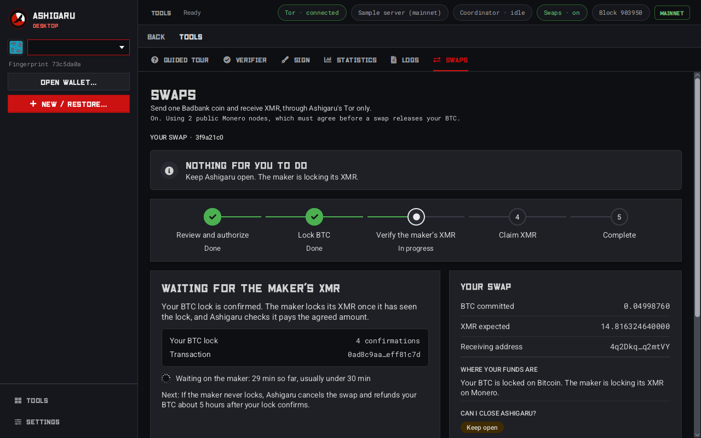

   Five stages (Review and authorize, Lock BTC, Verify the maker's XMR, Claim XMR, Complete) say where the swap is. The dashboard also says where your funds are, whether you
   can close Ashigaru (the swap pauses while it is closed and resumes when it starts, with swaps on), and what happens if the swap stalls. A swap needs **one**
   Bitcoin confirmation on your lock before the maker locks its XMR; once the lock has one, the screen says it is waiting for the maker.

**If something goes wrong.** A running swap is cancelled and refunded to Badbank by Ashigaru itself once the cancel timelock (30 blocks, about 5 hours after your lock confirms)
allows, minus network fees; the refund must be published within about 24 hours of the cancel. A swap that is not running has a **Cancel and refund** button once the timelock has
expired. A maker that refuses is left out of the offers for that coin.

What leaves your computer: the swap engine talks to makers, your Bitcoin server and the Monero nodes you tick, all through Tor (a Bitcoin server on your own network is reached directly).
The market price comes from Kraken over Tor.

## Tools

### Sign

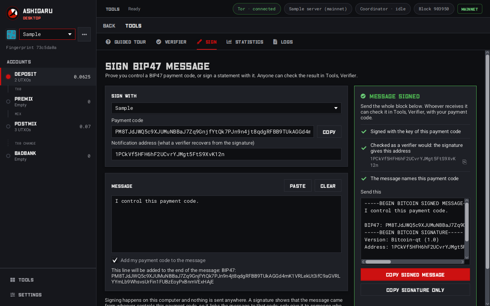

**Tools → Sign** signs a message as an open wallet's BIP47 payment code, so someone with your payment code can check it in the Verifier (or any BIP47 verifier). The payment code and its
notification address are shown first. By default a line naming your payment code is added to the message, and the screen says exactly what will be added. Signing happens on this computer, needs no password
(an open wallet already holds this key) and sends nothing. Watch-only and hardware wallets have no payment code and are not listed. Before showing the block, Ashigaru reads it
back the way the Verifier does, so a block that would not verify is never handed out.

### Verifier

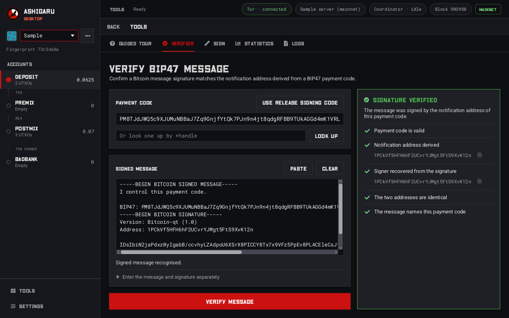

**Tools → Verifier** checks that a message was signed by the notification address of a BIP47 payment code. Paste the whole signed block into one box; it is read as you paste. **Use Release Signing Code** fills in
Ashigaru's own release signing identity for checking a release. It lists each check (valid payment code, notification address, recovered signer, whether they match, and whether the message
names the payment code). A payment code can also be looked up from a +paynym handle, which contacts paynym.rs through Tor.

### Guided Tour, Statistics and Logs

- **Guided Tour** restarts the first-run walkthrough.
- **Statistics** shows the Whirlpool pools (total BTC, capacity, entries and unspent coins by block height), fetched from whirlpoolstats.xyz.
- **Logs** shows recent activity from `ashigaru.log` with addresses, keys and wallet names redacted. Copy or save it when reporting a problem. The saved report also says whether swaps are on,
  whether the engine loaded, and what the Swaps screen reports.

## Settings

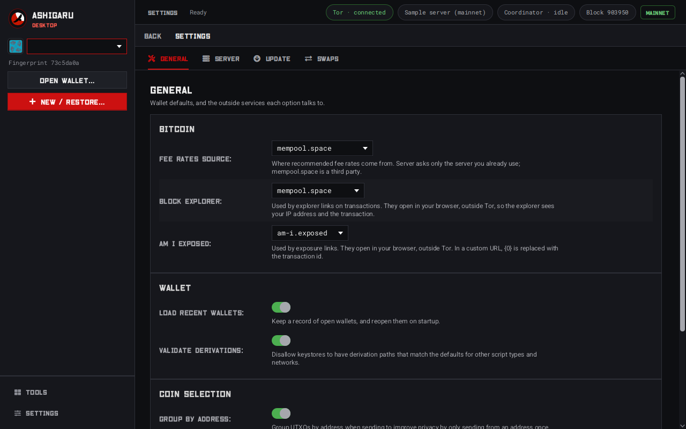

**General** holds the fee rate source (the server you use, or mempool.space), the block explorer and AmIExposed links (which open in your browser, outside Tor, through the *Leaving Tor* window), wallet defaults
and coin selection. **Server** has the Tor and server path at a glance, the server type (public, or your own Electrum or Dojo), a proxy, **Test Connection** and **Restart Tor**; right-clicking the
connection status in the top bar offers a new Tor identity or a Tor restart too.

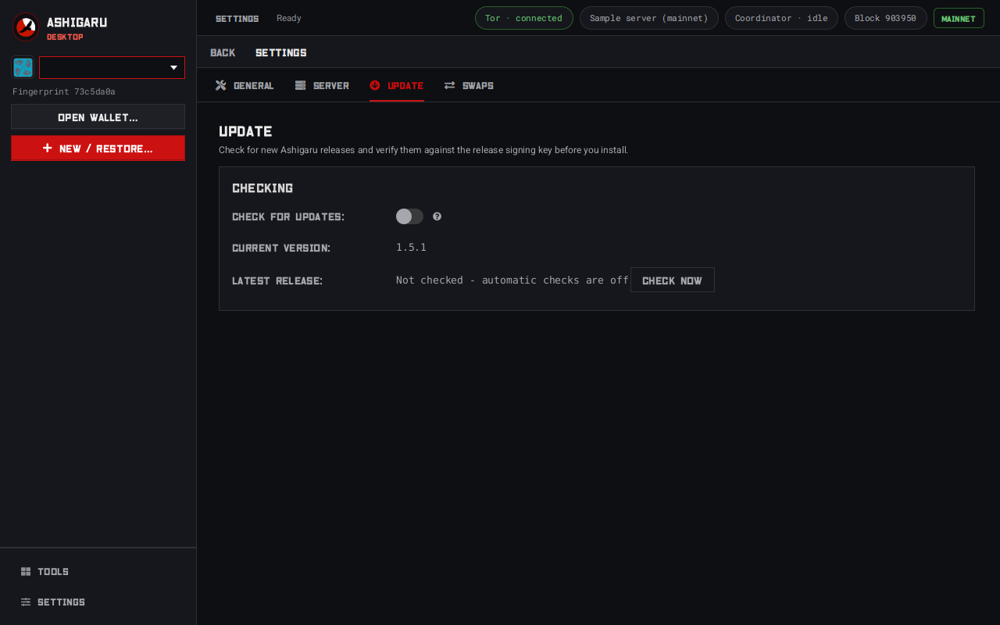

**Update** controls update checks (off until you allow them), shows the current version and checks for the latest release.

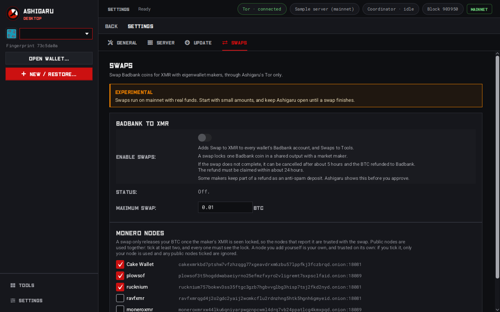

**Swaps** switches swaps on, sets the maximum swap size, and chooses the Monero nodes the swap needs to agree. Public nodes are used together (tick at least two); your own node, if ticked, is used alone.
The Monero node settings are greyed out while swaps are on, like the Bitcoin server.

## What leaves your computer

| What | Goes to | How |
|---|---|---|
| Wallet synchronisation | The Electrum or Dojo server you chose | Through Tor (a server on your own network directly) |
| Whirlpool mixing | The Whirlpool coordinator | Through Tor |
| Fee rates | Your server, or mempool.space if chosen | Through Tor |
| PayNym robot, +handle lookup | paynym.rs | Through Tor. Tells paynym.rs the wallet's payment code |
| Pool statistics | whirlpoolstats.xyz | Through Tor |
| Swaps | Makers, your Bitcoin server, the Monero nodes you tick, Kraken for the market price | Through Tor only |
| Block explorer and AmIExposed links | Your browser | Outside Tor, after the *Leaving Tor* window |
| Pair with Sentinel, Sign, seed words | Nowhere | Nothing is sent |
| Update checks | GitHub | Only when you have allowed them |

## Updates, releases and builds

- **Verified updates.** When you allow it, Ashigaru finds new releases and checks them against the release signing key before you install (the AppImage on Linux, the installer on Windows).
- **Signed and attested releases.** Each release carries `SHA256SUMS`, `MESSAGE.txt` and a BIP47 signature, and a GitHub build attestation. The README's *Verifying a release* says how to check them and what each proves;
  [ReleaseFormat.md](ReleaseFormat.md) fixes the file names and fields other tools rely on.
- **Which build is this?** The window title, About and Settings → Logs show the version and commit (for example `1.5.81+f6833e3`). Quote it with anything you report.
- **Reproducible builds.** See [ReproducibleBuilds.md](ReproducibleBuilds.md).
